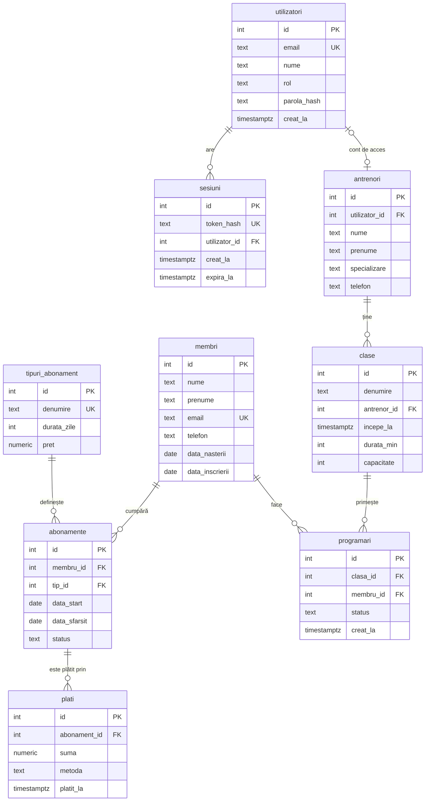

# Progres Fit – documentația proiectului

Aplicație web de gestiune pentru o sală de fitness fictivă, **Progres Fit**.
Proiect individual la disciplina *Baze de date avansate*.

## Cuprins

1. [Domeniul temei](#1-domeniul-temei)
2. [Tehnologii și pornire](#2-tehnologii-și-pornire)
3. [Modelul de date](#3-modelul-de-date)
4. [Fixtures](#4-fixtures)
5. [Operații CRUD și API](#5-operații-crud-și-api)
6. [Autentificare](#6-autentificare)
7. [Roluri](#7-roluri)
8. [Paginile interfeței](#8-paginile-interfeței)
9. [Indecși](#9-indecși)
10. [Load test](#10-load-test)
11. [Rapoarte](#11-rapoarte)
12. [Teste automate](#12-teste-automate)
13. [Limitări cunoscute](#13-limitări-cunoscute)

---

## 1. Domeniul temei

O sală de fitness are nevoie să țină evidența:

- **membrilor** înscriși și a datelor lor de contact;
- **abonamentelor** cumpărate de fiecare membru (ce tip, de când până când, în ce stare);
- **plăților** încasate pentru abonamente;
- **antrenorilor** și a **claselor** de grup pe care le țin (Yoga, CrossFit etc.);
- **programărilor** membrilor la clase;
- **angajaților** care folosesc aplicația și a drepturilor fiecăruia.

Aplicația este folosită de personalul sălii, nu de membri. Există trei tipuri de angajați:
administratorul, recepționerul și antrenorul (vezi [Roluri](#7-roluri)).

## 2. Tehnologii și pornire

| Componentă | Tehnologie |
|---|---|
| SGBD (unul singur, relațional) | **PostgreSQL**, găzduit în Supabase |
| Server / API | Node.js 24 + Express 5 |
| Acces la baza de date | driverul `pg`, SQL scris de mână (fără ORM) |
| Autentificare | implementare proprie: `scrypt` + sesiuni în tabelul `sesiuni` |
| Interfață | HTML, CSS și JavaScript simplu, fără framework |
| Rapoarte PDF | `pdfkit` |
| Load test | `autocannon` |
| Teste | `node:test` (inclus în Node) |

Din Supabase se folosește **doar baza de date PostgreSQL**. Nu se folosesc Supabase Auth și nici
API-ul REST generat automat: autentificarea și API-ul sunt scrise în `server.js`.

### Pornire

```bash
npm install
```

Se copiază `.env.example` în `.env` și se completează `DATABASE_URL` cu connection string-ul din
Supabase (*Connect → Connection string → Session pooler*, format URI). Apoi:

```bash
npm start
```

Aplicația rulează pe <http://localhost:3000>. La prima pornire creează tabelele și introduce
datele de test.

Dacă `DATABASE_URL` lipsește, aplicația pornește cu un PostgreSQL încorporat (PGlite), cu datele
în folderul `data/`. Este același motor PostgreSQL și același SQL; e util pentru lucru fără internet.

### Conturi demo

| Rol | Email | Parolă |
|---|---|---|
| admin | `admin@progresfit.ro` | `ProgresFit2026!` |
| receptioner | `receptie@progresfit.ro` | `ProgresFit2026!` |
| antrenor | `antrenor@progresfit.ro` | `ProgresFit2026!` |

### Structura proiectului

| Fișier | Rol |
|---|---|
| `schema.sql` | tabelele, relațiile și constrângerile |
| `indexes.sql` | indecșii |
| `seed.sql` | datele de test (fixtures) |
| `db.js` | conexiunea la PostgreSQL |
| `server.js` | API-ul: autentificare, roluri, CRUD, rapoarte, pornire |
| `public/` | interfața web |
| `scripts/explain.js` | generează planurile de execuție înainte/după indecși |
| `scripts/loadtest.js` | rulează load testul |
| `test/api.test.js` | teste automate |
| `docs/` | rezultatele generate: planuri de execuție și load test |

## 3. Modelul de date

Nouă tabele (cerința minimă: șase), definite în [`schema.sql`](schema.sql).



### Tabele

| Tabel | Ce reține |
|---|---|
| `utilizatori` | angajații care se pot autentifica, cu rolul și hash-ul parolei |
| `sesiuni` | sesiunile de autentificare active |
| `membri` | clienții sălii |
| `antrenori` | antrenorii; opțional legați de un cont din `utilizatori` |
| `tipuri_abonament` | oferta sălii: denumire, durată, preț |
| `abonamente` | abonamentul unui membru, pe o perioadă |
| `clase` | o clasă de grup programată la o dată și oră |
| `programari` | înscrierea unui membru la o clasă |
| `plati` | o încasare pentru un abonament |

### Relații și comportament la ștergere

| Cheie străină | Tip relație | La ștergerea părintelui |
|---|---|---|
| `sesiuni.utilizator_id → utilizatori` | N:1 | `CASCADE`: sesiunile dispar odată cu utilizatorul |
| `antrenori.utilizator_id → utilizatori` | 1:1 opțional (`UNIQUE`) | `SET NULL`: antrenorul rămâne, fără cont |
| `abonamente.membru_id → membri` | N:1 | `RESTRICT`: nu se șterge un membru cu abonamente |
| `abonamente.tip_id → tipuri_abonament` | N:1 | `RESTRICT` |
| `plati.abonament_id → abonamente` | N:1 | `RESTRICT`: istoricul financiar nu se pierde |
| `clase.antrenor_id → antrenori` | N:1 | `RESTRICT` |
| `programari.clasa_id → clase` | N:1 | `CASCADE` |
| `programari.membru_id → membri` | N:1 | `CASCADE` |

`programari` realizează relația N:M dintre `membri` și `clase`.

### Constrângeri

- **Chei primare**: `id` generat automat (`GENERATED ALWAYS AS IDENTITY`) în toate tabelele.
- **`NOT NULL`** pe toate câmpurile obligatorii.
- **`UNIQUE`**: emailul utilizatorilor și al membrilor, denumirea tipului de abonament,
  `token_hash`, perechea `(clasa_id, membru_id)` (un membru nu se poate programa de două ori la aceeași clasă).
- **`CHECK` pe valori permise**: `rol`, `status` (abonamente și programări), `metoda` de plată.
- **`CHECK` pe intervale**: `pret >= 0`, `suma > 0`, `durata_zile > 0`, `capacitate > 0`,
  `durata_min` între 15 și 240, `data_nasterii` în trecut.
- **`CHECK` între coloane**: `data_sfarsit >= data_start`.
- **`CHECK` pe format**: emailul conține `@` și este scris cu litere mici (unicitatea nu poate fi ocolită prin majuscule).
- **`DEFAULT`**: data înscrierii, data plății, statusul.

Validarea datelor este făcută de aceste constrângeri. Serverul traduce erorile PostgreSQL în
răspunsuri HTTP: `23505` (unicitate) și `23503`/`23001` (cheie străină) devin `409`, iar
`23514` (CHECK), `23502` (NOT NULL) și clasa `22` (format invalid) devin `400`.

Pe toate tabelele este activat **Row Level Security** fără nicio politică. Astfel API-ul REST
public pe care Supabase îl generează automat nu poate citi nimic; aplicația se conectează ca
proprietar al tabelelor și nu este afectată.

## 4. Fixtures

Datele de test se introduc **automat la pornirea serviciului**, în funcția `init()` din
`server.js`, dacă tabelul `utilizatori` este gol:

1. se rulează `schema.sql` și `indexes.sql` (idempotente, cu `IF NOT EXISTS`);
2. se inserează cele trei conturi demo, cu parola hash-uită în aplicație;
3. se rulează [`seed.sql`](seed.sql), care generează restul datelor cu `generate_series`.

| Tabel | Rânduri |
|---|---|
| `utilizatori` | 3 |
| `tipuri_abonament` | 5 |
| `antrenori` | 6 |
| `membri` | 5 000 |
| `abonamente` | 20 000 |
| `plati` | 19 500 |
| `clase` | 600 |
| `programari` | 7 200 |

Volumul este ales intenționat mare, ca indecșii și load testul să fie relevanți. Datele sunt
relative la data curentă (clase de acum 120 de zile până peste 30 de zile), deci rapoartele au
conținut oricând este pornită aplicația.

## 5. Operații CRUD și API

Toate entitățile au creare, citire, actualizare și ștergere, prin aceleași patru rute generice.
Fiecare tabel este descris o singură dată în obiectul `entitati` din `server.js` (coloane,
chei străine, drepturi), iar rutele și formularele din interfață rezultă din acea descriere.

| Operație | Rută | Răspuns |
|---|---|---|
| Citire (listă) | `GET /api/:entitate` | `200` + listă JSON |
| Creare | `POST /api/:entitate` | `201` + `{ id }` |
| Actualizare | `PUT /api/:entitate/:id` | `200` + `{ id }` |
| Ștergere | `DELETE /api/:entitate/:id` | `204` |

`:entitate` este unul dintre: `membri`, `abonamente`, `plati`, `clase`, `programari`,
`antrenori`, `tipuri_abonament`, `utilizatori`, `sesiuni`.

Parametri pentru listă:

- `limit` (implicit 50, maximum 200) și `offset` pentru paginare;
- `q` pentru căutare în eticheta înregistrării (de exemplu numele membrului);
- orice coloană a tabelului, pentru filtrare exactă: `GET /api/abonamente?membru_id=1234`.

Pentru fiecare cheie străină, lista întoarce și eticheta înregistrării referite
(`membru_id_eticheta: "Popescu Ana"`), ca interfața să nu afișeze doar numere.

Cazuri speciale:

- **`utilizatori`**: câmpul `parola` trimis de client este transformat în `parola_hash`.
  Hash-ul nu este returnat de nicio rută.
- **`sesiuni`**: crearea se face doar prin autentificare (`POST /api/sesiuni` răspunde `405`).
  Adminul le poate lista, le poate modifica data de expirare și le poate șterge (revocare).

Alte rute: `POST /api/login`, `POST /api/logout`, `GET /api/me`, `GET /api/rapoarte/:nume`.

Protecție împotriva SQL injection: valorile ajung în interogări doar ca parametri (`$1`, `$2`…),
iar numele de tabele și coloane provin exclusiv din descrierea de pe server, niciodată din cerere.

## 6. Autentificare

Implementare explicită, în `server.js`, fără biblioteci de autentificare.

### Stocarea parolelor

- Parola este trecută prin **scrypt** (`node:crypto`), o funcție de derivare lentă și costisitoare
  ca memorie, gândită să îngreuneze atacurile prin forță brută.
- Pentru fiecare parolă se generează un **salt aleator de 16 octeți**, deci două parole identice
  au hash-uri diferite.
- În coloana `parola_hash` se stochează `salt:hash` în hexazecimal. Parola în clar nu se
  stochează și nu se scrie în loguri.
- La verificare, comparația se face cu `timingSafeEqual`, în timp constant.
- Parola are minimum 8 caractere.

### Sesiuni

1. La `POST /api/login` cu email și parolă corecte, serverul generează un **token aleator de 256 de biți**.
2. În tabelul `sesiuni` se salvează doar **SHA-256 al tokenului**, împreună cu utilizatorul și
   data expirării (8 ore). Cine ar citi tabelul nu poate reconstitui tokenurile.
3. Tokenul ajunge la browser într-un cookie `sid` cu atributele:
   - `HttpOnly`: JavaScript-ul din pagină nu îl poate citi (protecție la XSS);
   - `SameSite=Strict`: nu este trimis la cereri pornite de pe alte site-uri (protecție la CSRF);
   - `Secure` atunci când conexiunea este HTTPS.
4. La fiecare cerere către `/api`, serverul caută hash-ul tokenului în `sesiuni`, verifică
   `expira_la > now()` și încarcă utilizatorul și rolul lui.
5. `POST /api/logout` șterge sesiunea din baza de date, deci tokenul devine inutilizabil imediat.

Alte măsuri:

- mesajul de eroare este același pentru email inexistent și pentru parolă greșită;
- schimbarea parolei unui utilizator îi șterge celelalte sesiuni;
- ștergerea unui utilizator îi șterge sesiunile (`ON DELETE CASCADE`);
- sesiunile expirate sunt curățate la fiecare autentificare.

## 7. Roluri

Trei roluri, reținute în `utilizatori.rol` și verificate pe server la fiecare cerere
(funcția `entitate()`). O cerere fără drept primește `403`. Interfața ascunde ce nu este
permis, dar decizia se ia întotdeauna pe server.

| Entitate | admin | receptioner | antrenor |
|---|---|---|---|
| Membri | citire + scriere | citire + scriere | citire |
| Abonamente | citire + scriere | citire + scriere | fără acces |
| Plăți | citire + scriere | citire + scriere | fără acces |
| Clase | citire + scriere | citire | citire + scriere |
| Programări | citire + scriere | citire + scriere | citire + scriere |
| Antrenori | citire + scriere | citire | citire |
| Tipuri de abonament | citire + scriere | citire | citire |
| Utilizatori | citire + scriere | fără acces | fără acces |
| Sesiuni | citire + scriere | fără acces | fără acces |
| Raport venituri | da | nu | nu |
| Raport expirări | da | da | nu |
| Raport ocupare clase | da | da | da |

Pe scurt: **adminul** configurează sala și vede banii, **recepționerul** lucrează cu membrii,
abonamentele și încasările, iar **antrenorul** își gestionează clasele și prezența, fără acces
la date financiare.

## 8. Paginile interfeței

Interfața este o singură pagină (`public/index.html`) care își schimbă conținutul. Meniul
afișează doar secțiunile permise rolului autentificat.

### Autentificare

Formular cu email și parolă. La date greșite afișează mesajul de eroare sub câmpuri. Apare
automat și atunci când sesiunea a expirat.

### Bara de sus

Prezentă pe toate paginile după autentificare: meniul cu secțiunile, numele și rolul
utilizatorului și butonul **Ieșire**, care închide sesiunea.

### Paginile de listă (câte una pentru fiecare entitate)

Toate au aceeași structură:

- titlul secțiunii și un câmp de **căutare**;
- butonul **+ Adaugă** (doar dacă rolul are drept de scriere);
- tabelul cu înregistrările, câte 50 pe pagină, cele mai noi primele;
- pentru fiecare rând, butoanele **Editează** și **Șterge** (doar cu drept de scriere);
- butoanele **Înapoi** și **Înainte** pentru paginare.

Ștergerea cere confirmare. Dacă baza de date o refuză (de exemplu un membru care are
abonamente), mesajul constrângerii este afișat utilizatorului.

| Pagină | Ce afișează | Căutare după |
|---|---|---|
| Membri | nume, prenume, email, telefon, data nașterii, data înscrierii | nume și prenume |
| Abonamente | membrul, tipul, perioada, statusul | numele membrului |
| Plăți | abonamentul, suma, metoda, data plății | sumă |
| Clase | denumirea, antrenorul, data și ora, durata, capacitatea | denumire și dată |
| Programări | clasa, membrul, statusul | număr |
| Antrenori | nume, prenume, specializare, telefon, contul asociat | nume și prenume |
| Tipuri de abonament | denumire, durata în zile, preț | denumire |
| Utilizatori | nume, email, rol | nume și email |
| Sesiuni | utilizatorul, data creării, data expirării | număr |

### Fereastra de adăugare / editare

Se deschide peste listă, cu câte un câmp pentru fiecare coloană:

- câmpurile de dată au selector de calendar;
- coloanele cu valori fixe (status, rol, metodă de plată) sunt liste derulante;
- cheile străine sunt câmpuri cu **căutare**: se scrie o parte din nume și se alege din
  sugestii (de exemplu membrul unui abonament);
- la utilizatori, parola este obligatorie la creare și opțională la editare.

Erorile de validare venite din baza de date apar în fereastră, fără a pierde datele completate.

### Rapoarte

Lista rapoartelor disponibile rolului curent. Fiecare se deschide ca PDF într-o filă nouă.

## 9. Indecși

PostgreSQL creează automat indecși doar pentru chei primare și constrângeri `UNIQUE`, **nu și
pentru chei străine**. Indecșii din [`indexes.sql`](indexes.sql) acoperă interogările pe care
aplicația le face efectiv:

| Index | Interogarea deservită | Înainte | După |
|---|---|---|---|
| `idx_abonamente_membru` pe `abonamente(membru_id)` | abonamentele unui membru | Seq Scan, 1.765 ms | Bitmap Heap Scan, 0.065 ms |
| `idx_abonamente_expirare` pe `abonamente(data_sfarsit) WHERE status = 'activ'` | raportul de expirări | Seq Scan, 3.874 ms | Bitmap Heap Scan, 0.571 ms |
| `idx_plati_platit_la` pe `plati(platit_la)` | încasările dintr-o perioadă | Seq Scan, 3.366 ms | Bitmap Heap Scan, 0.223 ms |
| `idx_plati_abonament` pe `plati(abonament_id)` | plățile unui abonament | Seq Scan, 1.906 ms | Index Scan, 0.043 ms |
| `idx_programari_membru` pe `programari(membru_id)` | programările unui membru | Seq Scan, 0.680 ms | Index Scan, 0.029 ms |

Planurile complete (`EXPLAIN (ANALYZE, BUFFERS)`), înainte și după, sunt în
[`docs/planuri-executie.md`](docs/planuri-executie.md). Se regenerează cu:

```bash
npm run explain
```

Scriptul șterge indecșii, măsoară, îi recreează și măsoară din nou.

Exemplu, pentru abonamentele unui membru. Fără index, PostgreSQL citește toate cele 20 000 de
rânduri (148 de pagini) și aruncă 19 996 dintre ele:

```
Seq Scan on abonamente  (cost=0.00..398.00 rows=4 width=26) (actual time=0.127..1.747 rows=4.00 loops=1)
  Filter: (membru_id = 1234)
  Rows Removed by Filter: 19996
  Buffers: shared hit=148
Execution Time: 1.765 ms
```

Cu index, citește doar 6 pagini, iar costul estimat scade de la 398 la 18:

```
Bitmap Heap Scan on abonamente  (cost=4.32..18.40 rows=4 width=26) (actual time=0.036..0.043 rows=4.00 loops=1)
  Recheck Cond: (membru_id = 1234)
  Buffers: shared hit=6
  ->  Bitmap Index Scan on idx_abonamente_membru  (cost=0.00..4.32 rows=4 width=0)
Execution Time: 0.065 ms
```

Observații:

- `idx_abonamente_expirare` este un **index parțial**: conține doar abonamentele active,
  singurele care interesează raportul, deci este mai mic decât un index pe toată coloana.
- Pe `programari(clasa_id)` nu există index separat, pentru că este prima coloană din
  constrângerea `UNIQUE (clasa_id, membru_id)`, al cărei index o acoperă deja.
- Pe `clase` nu s-a adăugat index: la 600 de rânduri tabelul încape în câteva pagini și
  planificatorul alege oricum scanarea secvențială.
- Căutarea după nume (`ILIKE '%text%'`) nu poate folosi un index B-tree și rămâne scanare
  secvențială. Efectul se vede în load test.

## 10. Load test

Testul rulează cu `autocannon` asupra serverului pornit:

```bash
npm run loadtest
```

Implicit sunt 50 de conexiuni simultane, 10 secunde per scenariu. Alte valori:
`npm run loadtest -- 100 20`. Rezultatele se scriu în [`docs/load-test.md`](docs/load-test.md).

Rezultate măsurate la 2026-11-12, pe baza locală (PGlite), 50 de conexiuni, 10 secunde:

| Scenariu | Cerere | Cereri/s | p50 (ms) | p97.5 (ms) | p99 (ms) | max (ms) | Erori |
|---|---|---|---|---|---|---|---|
| Listă paginată | `GET /api/membri?limit=50` | 489 | 97 | 145 | 185 | 194 | 0 |
| Căutare după nume (ILIKE) | `GET /api/membri?q=popescu&limit=50` | 167 | 292 | 384 | 388 | 430 | 0 |
| Filtru pe coloană indexată | `GET /api/abonamente?membru_id=1234` | 584 | 79 | 131 | 171 | 390 | 0 |
| Listă cu 2 etichete FK | `GET /api/abonamente?limit=50` | 321 | 150 | 199 | 209 | 269 | 0 |
| Scriere (UPDATE) | `PUT /api/membri/1` | 902 | 51 | 78 | 90 | 300 | 0 |

Interpretare:

- Nicio cerere nu a eșuat sub sarcină.
- Fiecare cerere face două interogări: verificarea sesiunii și operația propriu-zisă.
- Filtrarea pe coloana indexată este cel mai rapid scenariu de citire (584 cereri/s).
- Căutarea cu `ILIKE` este de aproximativ 3,5 ori mai lentă, pentru că scanează tot tabelul
  `membri`. Este limita explicată la capitolul Indecși.
- Lista de abonamente este mai lentă decât cea de membri pentru că fiecare rând aduce două
  etichete din alte tabele.

**Atenție:** aceste cifre sunt de pe baza locală încorporată, care execută interogările pe rând,
pe o singură conexiune. Pe Supabase rezultatele vor fi diferite: se adaugă latența de rețea până
la serverul din cloud, dar interogările rulează în paralel pe un pool de 10 conexiuni. Testul
trebuie rulat din nou după configurarea `DATABASE_URL`, iar tabelul de mai sus actualizat.

## 11. Rapoarte

Rapoartele sunt generate la cerere, din datele curente, în format **PDF** (`pdfkit`), la
`GET /api/rapoarte/:nume`. Fiecare conține titlul, data generării, numele utilizatorului care
l-a cerut și un tabel cu datele.

| Raport | Conținut | Roluri |
|---|---|---|
| `venituri` | totalul încasărilor pe luni și pe tipuri de abonament, ultimele 12 luni (agregare cu `GROUP BY` peste `plati`, `abonamente`, `tipuri_abonament`) | admin |
| `expirari` | abonamentele active care expiră în următoarele 7 zile, cu telefonul membrului | admin, receptioner |
| `ocupare` | clasele din următoarele 7 zile, cu numărul de rezervări față de capacitate | toate |

## 12. Teste automate

```bash
npm test
```

Testele din `test/api.test.js` pornesc aplicația pe o bază PostgreSQL în memorie și verifică:

- respingerea cererilor fără sesiune și a parolelor greșite;
- existența datelor de test după pornire;
- CRUD complet pe membri și respectarea constrângerilor (unicitate, CHECK, NOT NULL, cheie străină);
- drepturile diferite ale celor trei roluri;
- că hash-ul parolei nu apare în răspunsuri, că o parolă nouă funcționează și că sesiunea
  este invalidă după logout;
- că cele trei rapoarte sunt PDF-uri valide.

## 13. Limitări cunoscute

- **Diacritice în PDF**: fontul standard din PDF nu conține `ș`, `ț`, `ă`, deci rapoartele sunt
  scrise fără diacritice. Rezolvarea este includerea unui font TTF.
- **Capacitatea clasei** nu este impusă de baza de date: se pot face mai multe programări decât
  locuri. Ar necesita un trigger.
- **Antrenorul** poate modifica orice clasă, nu doar pe ale lui.
- **Fără limitare a încercărilor de autentificare** (rate limiting).
- **Certificatul TLS** al bazei de date nu este verificat (conexiunea este criptată, dar
  identitatea serverului nu este confirmată). Pentru producție se configurează certificatul CA din Supabase.
- **Căutarea după nume** nu folosește index (vezi capitolele 9 și 10).
